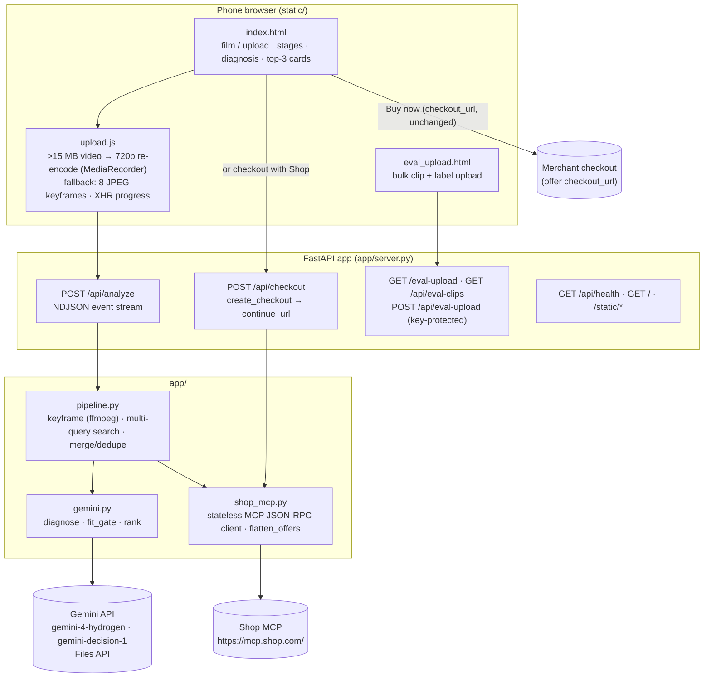
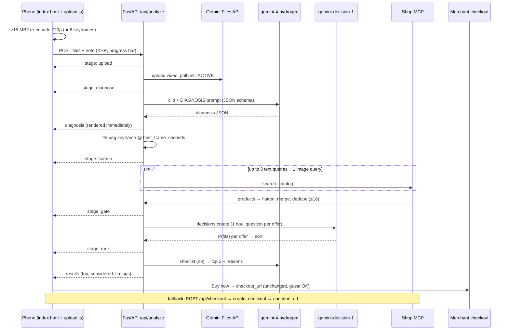

# Fix-It Cam: Architecture

## Components



| Component | File | Responsibility |
|---|---|---|
| Frontend | `static/index.html` | A mobile-first single page. **Film it** (`capture="environment"`) or **Upload**, an optional note, live stage list, upload progress bar, diagnosis card (spec chips tagged seen/heard/inferred, evidence timestamps that seek the preview video), top-3 product cards (merchant image from its original URL, price, seller, rating, fit %, reason, "check" note), **Buy now**, **View**, and a small "or checkout with Shop" link. |
| Upload helper | `static/upload.js` | `prepare()`: if a video is over 15 MB, re-encode it in the browser. It plays the clip in a hidden `<video>`, draws frames to a canvas scaled so the short side is 720 px, records with `MediaRecorder` (mp4/avc1 preferred, else webm) at 2 Mbps, caps at 15 s, and keeps audio via WebAudio when allowed. If that fails, it samples 8 JPEG keyframes named `frame_NN_tX.Xs.jpg`. `upload()` uses XHR with upload progress, incremental reads of the streamed response, and a 10 min timeout with clear error messages. |
| Eval upload page | `static/eval_upload.html` | Bulk-upload clips of one item with expected keywords and a description. It re-encodes big clips the same way, never as keyframes. |
| Server | `app/server.py` | FastAPI app (served by uvicorn via `python -m app.server`, wrapped by `run.sh`). The endpoints are listed below. |
| Pipeline | `app/pipeline.py` | `media_part` (Files API for video, inline bytes for a photo), `frames_parts` (several keyframes → interleaved "Frame i at mm:ss" + image parts), `extract_frame` (ffmpeg at Gemini's `best_frame_seconds`), `search_offers` (up to 3 text queries + 1 image-plus-text query in parallel, round-robin merge, dedupe by variant, max `MAX_CANDIDATES`=18), and `run()` (end to end, used by eval and the smoke test). |
| Gemini | `app/gemini.py` | `upload_media`, `diagnose`, `fit_gate`, `rank` (details below). |
| Shop MCP client | `app/shop_mcp.py` | `ShopMCP` (`list_tools`, `call`, `search_catalog`, `create_checkout`) and `flatten_offers`. |
| Eval | `eval/eval.py` | Full vs baseline harness (below). |
| Smoke test | `scripts/smoke_test.py` | CLI: clip → diagnosis → top 3 → a real `create_checkout` `continue_url` (no purchase). |

## Server endpoints (`app/server.py`)

| Method & path | Purpose |
|---|---|
| `GET /` | Serves `static/index.html` (no-store). |
| `GET /static/*` | Static assets (`upload.js`, `eval_upload.html`). |
| `GET /api/health` | `{ok, identify_model, rank_model, gate_model, gemini_key: bool}`. It never returns the key itself. |
| `POST /api/analyze` | Multipart `files` (one video, one photo, or up to 16 ordered keyframes), a legacy `file` field, and `note`. Size cap `MAX_UPLOAD_MB` (default 200). It responds with **`application/x-ndjson`** events: `stage` (upload / diagnose / search / gate / rank), `diagnosis`, `results` (`top`, `considered`, `timings`), or `error`. Temp files are deleted at the end. |
| `POST /api/checkout` | JSON `{shop, variant_id, quantity}` → Shop MCP `create_checkout` → `{continue_url, status, total_minor, currency}`. Used by the fallback path only. |
| `GET /eval-upload?k=` · `GET /api/eval-clips?k=` · `POST /api/eval-upload` | Eval clip collection into `eval/clips/` + `eval/clips/labels.json` (both git-ignored). If `EVAL_UPLOAD_KEY` is set, requests must carry it (403 otherwise). |

## Gemini calls (`app/gemini.py`)

| Function | Model (env override) | Input → output |
|---|---|---|
| `upload_media` | Files API | A video file is uploaded and polled until `ACTIVE` (120 s timeout). |
| `diagnose` | `gemini-4-hydrogen` (`IDENTIFY_MODEL`; thinking from `DIAGNOSE_THINKING`, default model setting) | Video / photo / keyframe sequence + prompt → JSON (`DIAGNOSIS_SCHEMA`): `item, brand, model, broken_part, failure, specs[{name,value,source: seen/heard/inferred}], evidence[{t: mm:ss, observation}], replace, repair_tip, search_queries[2-3], best_frame_seconds, confidence, uncertainties[]`. Temperature 0.2. |
| `fit_gate` | **Decisions API** `gemini-decision-1` (`DECISION_MODEL`) | One `client.decisions.create` call: shared input = a diagnosis summary, plus one `noul` (yes/no) question per candidate: "would buying this be a correct, compatible replacement?" → calibrated P(yes) per offer. About 0.3–0.8 s for 18 offers. |
| `rank` | `gemini-4-hydrogen` (`RANK_MODEL`, thinking `low` via `RANK_THINKING`) | Diagnosis + up to 8 shortlisted offers (with `fit_prob`) → JSON `picks[{index, reason ≤20 words, check ≤12 words}]` → top 3. |

The eval judge (`eval/eval.py`) uses `RANK_MODEL` with thinking `low` and temperature 0.

## Shop MCP client (`app/shop_mcp.py`)

The server at `https://mcp.shop.com/` speaks MCP protocol **`2026-07-28`** and is **stateless**: there is no `initialize` handshake and no session id. Every request is a single JSON-RPC POST with:

```
Content-Type: application/json
Accept: application/json, text/event-stream
MCP-Protocol-Version: 2026-07-28
Mcp-Method: tools/call            (or tools/list)
Mcp-Name: <tool name>             (for tools/call)
```

and a body whose `params._meta` contains `io.modelcontextprotocol/protocolVersion: "2026-07-28"` and `io.modelcontextprotocol/clientCapabilities: {}`.
Responses may be plain JSON or SSE `data:` lines (both are parsed). Tool output comes from `structuredContent`, or else from the JSON in `content[].text`. `isError` raises `ShopMCPError`.

Tools used:

- **`search_catalog`** with `catalog: {query?, like?: [{image: {content_type, data(base64)}}], context: {address_country: "US", currency: "USD"}, filters: {available: true}, pagination: {limit: 6}}`. No API key is needed.
- **`create_checkout`** with `{shop: <seller.domain>, checkout: {line_items: [{item: {id: <variant gid>}, quantity}], context: {address_country}}}`. It returns `continue_url`, `status` (`incomplete` / `requires_escalation` are normal, because the buyer finishes on the page), `totals`, and `messages`.
- **`complete_checkout` is never called.**

Results are fetched live per request and never cached. Merchant images are loaded from their original URLs and never re-hosted.

### Offer shape (`flatten_offers`, one per product, first available variant)

```json
{
  "product_id": "gid://shopify/p/…",
  "variant_id": "gid://shopify/ProductVariant/…",
  "title": "…", "variant_title": "…",
  "description": "plain text, ≤400 chars", "features": ["…"],
  "price_minor": 949, "currency": "USD",
  "image_url": "https://cdn.shopify.com/…",
  "product_url": "https://merchant/products/…?variant=…&_gsid=…",
  "checkout_url": "https://merchant/buy/<variant>:1?ucp/version=…&context/payment/0/handler=dev.shopify.shop_pay",
  "seller_name": "…", "shop": "<seller>.myshopify.com",
  "rating": 4.9, "rating_count": 16,
  "found_by": "text: <query>" | "photo + text",
  "fit": 0.91,                       // added by fit_gate
  "reason": "…", "check": "…"        // added by rank (top 3 only)
}
```

## Buy paths

**Buy now** opens an in-app bottom sheet first. It shows the product image (`image_url` as returned), title, price, seller, the reason and the check note, a prominent **Checkout** button, and a small "or checkout with Shop" link. The checkout pages can't be embedded: the merchant `/buy` redirect and `shop.app` send `X-Frame-Options: DENY` and `frame-ancestors 'none'`, and the final checkout page only allows its own shop domains. So **Checkout** hands off with `window.open(checkout_url)`, or the same tab if the popup is blocked.

1. **Primary: Checkout → offer `checkout_url`.** It opens the `checkout_url` returned by `search_catalog` **exactly as returned** (no parameter edits). It redirects to the merchant's Shop Pay checkout, which offers **"Check out as guest"**. This was confirmed on a real iPhone in Safari, and the page data has `checkoutAsGuest: VISIBLE` when fetched with an iPhone user agent. No server round-trip is needed.
2. **Fallback: "or checkout with Shop" → `create_checkout` → `continue_url`.** The page opens a blank tab synchronously (to avoid popup blockers), calls `POST /api/checkout`, then sends that tab to `continue_url` unchanged. On phones this is a `shop.app` page that asks you to sign in. Buy now also uses this path if an offer has no `checkout_url`.

There is one merchant per checkout. The shopper reviews and pays on the merchant's page. The app never completes a purchase.

## Request sequence



## Latency (measured on the sample runs)

| Stage | Typical |
|---|---|
| Upload to Files API (small clip) | 0–3 s (6.8 s for a 68 MB 4K file) |
| `diagnose` (gemini-4-hydrogen) | 6–20 s; the largest and most variable stage |
| Shop search (parallel) | 0.7–1.8 s |
| Decisions fit gate | 0.3–0.8 s |
| `rank` (thinking low) | 2–8 s |
| **End to end** | **~17–30 s** (median 21 s on the 17-clip eval; an outlier at 53 s) |
| Browser re-encode of a big clip | about the clip length (68 MB 4K → 1.46 MB in 12 s, desktop Chrome) |

## Eval harness (`eval/eval.py`)

- **Inputs:** a clips folder + `labels.json` (`{clip: {keywords[], description, set?}}`). Defaults to `eval/clips/`, and `--clips eval/samples` runs the public sample set.
- **Systems:**
  - `full` = `pipeline.run()`.
  - `baseline` = the middle still frame (ffprobe duration / 2) → Gemini writes one plain query (thinking low) → one `search_catalog` text search → the first 3 results, with no gate and no ranking.
- **Metrics:**
  - `kw@1/kw@3`: all expected keywords appear in the offer's title, variant or description.
  - `judge@1/judge@3`: a strict Gemini judge sees the ground-truth description, keywords and the offers, and decides whether each offer would fix it.
  - Latency.
- **Output:** `eval/results/<timestamp>/{results.json, summary.md, failures.md}`. `--concurrency`, `--limit` and `--systems` are flags.
- Sample clips, sources and licenses are in `eval/samples/` (`SOURCES.md`). Synthetic clips are rebuilt with `make_samples.sh`.

## Deployment

- **Local:** `cp .env.example .env` (set `GEMINI_API_KEY`), then `./run.sh`. This creates `.venv`, installs `requirements.txt` and serves on `0.0.0.0:${PORT:-8000}`. It needs Python 3.11+ and `ffmpeg`/`ffprobe` (for keyframes and the eval baseline).
- **Demo setup:** the app runs on a Mac, exposed with a **cloudflared quick tunnel using `--protocol http2`** (`cloudflared tunnel --protocol http2 --url http://localhost:8000`). It prints a temporary `https://….trycloudflare.com` URL, and phone camera capture needs HTTPS. The project lives on an **APFS sparse disk image** on the Mac. Tunnel URLs are temporary and are not recorded in this repo.

## Security

- `GEMINI_API_KEY` is read from the environment / `.env` (`python-dotenv`). `.env` is git-ignored, and `.env.example` holds placeholders only. `/api/health` reports only whether a key is present.
- Shop MCP search and checkout need no API key. No buyer data is stored, and checkouts are created anonymously.
- `/eval-upload` and its APIs require `EVAL_UPLOAD_KEY` when set. Uploaded eval clips stay in `eval/clips/`, which is git-ignored.
- Uploads are size-capped (`MAX_UPLOAD_MB`), limited to video/image MIME types, and analyze temp files are deleted after each request.
- Product, checkout and image URLs are passed through unchanged and rendered with HTML escaping.

## Failure modes

| Failure | Behaviour |
|---|---|
| Huge phone video / slow Wi-Fi | Client re-encode or keyframes, a progress bar, and timeout and network errors shown in the UI. |
| Browser can't record (no MediaRecorder / captureStream) | 8 keyframes are sent. Accuracy is lower (a 4K MagSafe clip was read as "a pen" from keyframes). |
| No model number visible or audible | The diagnosis gives a family plus `uncertainties`, and the ranking adds a "check before buying" note. |
| Catalog lacks the exact part | The closest generic or whole-item replacement is shown, or "No matching part found" if nothing remains. |
| Search returns the wrong category (e.g. fixtures for a bulb) | The gate and ranking usually demote these, but not always (seen in the eval). |
| Decisions API error | The gate is skipped (`timings.gate_error`), and ranking still runs. |
| Shop MCP / Gemini error | An `error` event is streamed and the UI shows the message. |
| Offer has no `checkout_url` | Buy now falls back to `create_checkout`. |

## Future work

- **End-of-day closing report (Carbon).** Today's traces (diagnoses with confidence, Decisions fit-gate scores, rankings, buy/skip/checkout events, latencies) would be batched at closing time to `gemini-4-carbon` for deep reasoning: repeat failures and root causes, band-aid buys, spare parts to stock, where the app was unsure or wrong, a pre-service checklist, and a spend and overpricing summary. `gemini-4-hydrogen` stays the live path. **Not implemented.** The eval traces in `eval/results/*/results.json` are the intended first input. See PLAN.md, milestone 8.
