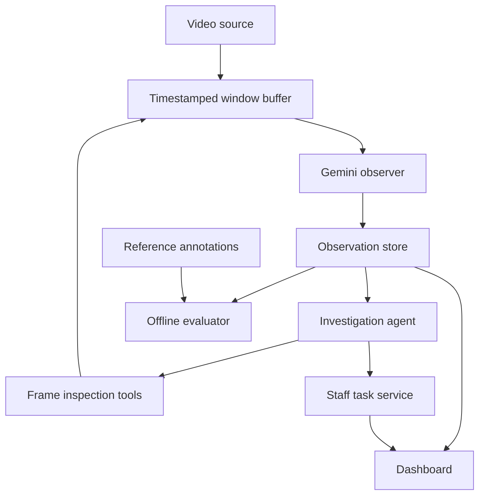

# Café Operations Agent — Implementation Plan

Date: 2026-11-21
Status: First implementation in this repository. The synthetic scenario exercises the full workflow. See [README.md](README.md) for setup and [agent.md](agent.md) for runtime behavior and the proposed Carbon closing review.
First release: A runnable local application with real Gemini inference, video evidence, staff tasks, and a separate evaluator.

## 1. Product goal

Build an operations assistant that watches café footage, remembers observations, investigates ambiguous changes, and creates justified staff tasks.

The first operational question is: **Who is actually waiting to order, and does the queue need staff attention?** The application should distinguish queue members from people standing nearby, including customers waiting alone. It should explain an alert using the actual footage that supports it.

The intended demonstration is a crowded scene in which an initial observation is ambiguous. The agent inspects additional available footage, revises or confirms its interpretation, and either creates a staff task or explains why it held off. This is a demonstration target, not an achieved result.

## 2. Scope and decisions

| Area | First-release decision | Reason |
| --- | --- | --- |
| Data | Use a small Café subset as footage and evaluation material | Establish a measurable problem without training a new model |
| Operational feature | Queue monitoring and evidence-backed staff tasks | Gives the demo a specific decision and observable outcome |
| Other activities | Display queueing, ordering, eating, working, fighting, selfie, or unknown as candidate observations when supported by footage | Preserve the dataset vocabulary while limiting operational scope |
| Models | Start with Hydrogen; make the verification model configurable | Measure whether a second model improves the result before adding more roles |
| Input | Uploaded video and clearly labeled dataset replay first; webcam through the same analysis interface afterward | Make the first end-to-end path reproducible |
| Memory | Persist observations, changes, investigations, and tasks | Support reasoning over time without claiming reliable customer identity tracking |
| Actions | Create, update, acknowledge, and resolve tasks inside the app | Demonstrate useful actions with visible results |
| Evaluation | Separate evaluator, held-out footage, explicit metrics | Make errors and improvements inspectable |
| Initial runtime | Local Python backend and web frontend | Minimize deployment dependencies during the first build |

Deferred: model training, all-four-model orchestration, individual wait times, table turnover, multi-camera identity tracking, floor-plan reconstruction, inventory or POS integration, Shopify checkout, and external staff notifications. Incident-response automation for the other activity classes is also outside the first release.

## 3. What is known and what must be validated

Known from the current project context and cited documentation:

- The user reports Gemini Tier 3 access to the four event models. The [two-request smoke test](docs/evaluation.md#verified-results) verified Hydrogen access using the configured GitHub Actions secret.
- Hydrogen supports video input, structured output, and function calling. Its Live API is unsupported; periodic inference requests are the initial design.
- Tier 3 does not guarantee capacity or eliminate throttling.
- Café provides six-second clips, actor tracklets, group membership, and group activity annotations.
- Café treats singleton people as outliers and does not assign them a group activity. An outlier label therefore does not tell us whether a person is waiting in the operational queue.

First-build checks:

| Check | Required evidence | Response if it fails |
| --- | --- | --- |
| Small data subset is obtainable | Readable clips paired with their actual annotations | Continue the upload-video pipeline; leave the Café benchmark explicitly pending |
| API access works | Successful server-side request with the configured model | Surface the access error; keep live inference disabled until resolved |
| Structured observations are usable | Pilot outputs on varied clips, including omissions and invalid responses | Revise the schema, prompt, or sampling strategy using development footage |
| Analysis is timely enough | Measured end-to-end latency and observation age | Reduce input size or cadence; expose the remaining delay |
| Group localization is adequate | Pilot matching against annotated actors | Test an independent detector/tracker adapter if needed; re-evaluate the complete pipeline |
| Event-specific API is required | Current organizer instructions | Add the required integration explicitly before making a track-eligibility claim |

No accuracy, throughput, cost, or winning-placement claim is established by this plan. Current event rules and submission requirements must be checked before submission.

## 4. Architecture

Reference annotations have no path into runtime prompts, investigation tools, or application memory. Evaluation output can be displayed in a separate dashboard panel.

### Technology choices

| Layer | Choice |
| --- | --- |
| Backend | Python with FastAPI and Pydantic validation |
| Video processing | FFmpeg/OpenCV for decoding, timestamped sampling, and evidence extraction |
| Model adapter | Gemini GenerateContent REST API, isolated behind an application interface |
| Frontend | React, TypeScript, and Vite |
| Live updates | Server-sent events for observations, task changes, and run status |
| Storage | SQLite for runs, observations, investigations, tasks, and evaluation records; local files for video/evidence |
| Configuration | Backend environment variables and a checked-in example without credentials |
| Packaging | Reproducible dependency versions, documented local startup, and a container option after the core path works |

See [docs/decisions.md](docs/decisions.md) for implementation choices and [docs/evaluation.md](docs/evaluation.md) for verification status.

## 5. Input and time handling

Every run has a source ID, session ID, configuration ID, and source-time watermark. Keep video time separate from wall-clock request and response times.

Initial experimental settings are a four-to-six-second rolling window and approximately one sampled frame per second. These are tunable starting values, not promised performance.

- Send only frames at or before the current source-time watermark. Do not upload an entire future-containing recording and rely on a prompt to hide future events.
- Use a bounded request queue, initially one observer request in flight. Coalesce pending work to the newest window instead of building an increasing backlog.
- Keep a small, separately bounded budget for investigations. Log additional calls, frames, and tokens.
- Show the analyzed interval, last successful update, and current observation age in the UI.
- Reject stale or out-of-order responses from changing current state.
- Seeking backward, changing sources, or restarting playback starts a new session and invalidates pending work. Historical results may remain in history but cannot update the new session.
- Pausing playback stops advancing source time. Replaying unrelated clips never creates a continuous customer history.
- Handle timeouts and rate limits with bounded retries and backoff. A failed request produces an unavailable or stale state, not a fabricated observation.
- Webcam mode uses the same schema and ordering rules. Its frames come from the browser, with credentials kept on the backend.

## 6. Observation and persistence contracts

The observer returns schema-validated data. Schema validity proves structural correctness only; it does not establish that the visual interpretation is correct.

| Record | Minimum fields |
| --- | --- |
| Run | Run/session/source IDs, source type, configuration hash, model ID, prompt/schema versions, start/end status |
| Observation | Analyzed time interval, sampled frame timestamps, request/response times, people, groups, queue estimate, uncertainty, evidence references |
| Person candidate | Window-local ID, normalized bounding box, queue-membership assessment, optional group reference, uncertainty |
| Group candidate | Window-local ID, member references, candidate activity, supporting evidence |
| Investigation | Trigger, evidence requested, tool calls, outcome, explanation, elapsed time, usage |
| Staff task | Task ID, run/session, task type, status, evidence interval, reason, creation/update times, deduplication key |
| Evaluation result | Dataset/annotation versions, split, run IDs, metric definitions, values, coverage, latency and usage summaries |

Important conventions:

- Group IDs and person IDs from a model response are local to that observation unless a separately tested association method establishes continuity.
- Queue membership is separate from social-group membership. A person with no group can still be queueing.
- Unknown counts are nullable or represented as a range. They never silently become zero.
- Model-reported confidence is an uncalibrated signal; the interface must not display it as measured accuracy.
- Validate coordinates, timestamps, member references, allowed activities, and evidence existence before using a response.
- Persistent memory initially describes scene and queue changes. Individual duration metrics remain deferred.

## 7. Investigation and task behavior

The observer proposes observations. The investigation agent can inspect more evidence and propose an action. Application code enforces timestamps, evidence requirements, tool budgets, and valid task transitions.

| Tool | Behavior and constraint |
| --- | --- |
| `inspect_frames(start, end, sample_count)` | Return frames within the current session and observed watermark; enforce a maximum sample count |
| `inspect_region(timestamp, bbox)` | Return a crop from an available frame, with its original timestamp and coordinates |
| `compare_observations(ids)` | Retrieve earlier observations and their evidence; preserve uncertainty and source/session boundaries |
| `create_staff_task(type, reason, evidence_ids)` | Validate evidence freshness and existence; deduplicate against active tasks |
| `update_staff_task(task_id, reason, evidence_ids)` | Attach new evidence to the existing task when the condition persists or changes |
| `resolve_staff_task(task_id, reason, evidence_ids)` | Require supporting evidence of resolution; missing or stale footage cannot resolve a task |

The first task type is `queue_attention`. Queue-size thresholds, persistence requirements, hysteresis, and cooldowns are configurable and frozen before held-out evaluation. Policy values are selected on development footage rather than presented as universal staffing rules.

Possible investigation outcomes are: create a task, update a task, resolve a task, no action justified, or insufficient evidence. Uncertainty is a valid outcome. A second model call is additional evidence gathering, not an independent guarantee of correctness.

Managed Agents can be integrated if required by the selected event track or shown useful in the pilot. A background request alone does not implement business actions; the app must still execute and record task operations.

## 8. Dashboard

The main view contains:

- **Video area:** play/pause, source selection, timeline position, and optional predicted people/group overlays. Distinguish replay from live input.
- **Current observations:** estimated queue size or range, group activities, uncertainty, analyzed interval, and observation age.
- **Staff task panel:** active and resolved tasks, reasons, acknowledgment controls, and investigation status.
- **Evidence timeline:** observations, investigations, and task changes. Clicking evidence seeks to the relevant video interval.
- **Evaluation view:** baseline versus agent results, sample size, missing predictions, error examples, and usage/latency differences.

Use a restrained visual design with clear hierarchy. Avoid a wall of charts. Show estimated state and failures plainly. A prerecorded result may be available as a fallback only when explicitly labeled with its recorded run and configuration; it must never appear to be fresh inference.

## 9. Data and evaluation plan

### Data preparation

1. Inspect the official distribution and obtain the smallest practical subset with paired labels. Do not begin by downloading the full dataset.
2. Create a manifest containing source URLs, file checksums, clip/source/café/view identifiers, annotation versions, frame rate, and timestamp conventions.
3. Target approximately 10 development clips and 20 held-out clips for the initial exploratory benchmark, subject to actual availability. Include queue scenes, nearby non-queue groups, lone customers, occlusion, and poor visibility.
4. Split by source recording and preferably café, following the purpose of the official place/view splits. Keep overlapping footage and synchronized views of the same scene in the same partition.
5. Add reviewed operational queue-membership labels for the subset, including singleton customers. Record ambiguous people as uncertain; do not invent certainty.
6. Use separate continuous footage with reviewed event onset times for persistence and alert-timing tests. Six-second activity clips alone do not establish full visits or long queue histories.
7. Record the terms applicable to the dataset and footage before redistribution; do not infer dataset permissions from the project website's license.

If continuous footage or paired labels are unavailable, mark the corresponding metrics unavailable and report the remaining evaluation scope accurately.

### Baseline and experimental comparison

- **Baseline:** one stateless call per selected window with the same observer model and output schema, followed by a documented simple task policy.
- **Agent:** the same initial observations plus temporal memory, bounded evidence inspection, and task management.
- Evaluate both on the same held-out scenes and starting windows.
- Report extra frames, requests, token usage, elapsed time, and failures for the agent. Additional work is part of its cost; do not imply equal compute.
- Freeze prompts, policy values, and model configuration before the held-out run. Changes made after examining failures require a new evaluation split or an explicitly labeled development rerun.

### Metrics

| Metric | Definition / requirement |
| --- | --- |
| Queue-count error | Mean absolute error against reviewed operational queue counts on scorable frames; report uncertain frames separately |
| Prediction coverage | Fraction of eligible windows with a usable estimate; unknown and failed outputs remain visible |
| Group-membership quality | Match predicted actors to reference actors, then evaluate membership; do not compare arbitrary ID strings |
| Activity quality | Class confusion and appropriate precision/recall on matched, scorable groups |
| Alert precision and recall | Compare task events to reviewed alert conditions, with a predeclared event-matching rule |
| False alerts and duplicates | False tasks per evaluated duration and duplicate tasks per event |
| Detection delay | Source-time interval between reviewed event onset and the decision; requires continuous labeled footage |
| Response latency | Wall-clock request-to-result median and p95 |
| Observation age | Age of the analyzed source information when displayed or acted on |
| Usage | Calls, frames, tokens, and estimated cost using dated prices; retain raw usage records |

For actor matching, document coordinate transformations, missing detections, one-to-one matching, and overlap thresholds. If reporting official Café Group mAP or Outlier mIoU, reproduce the relevant protocol and distinguish detected-box evaluation from ground-truth-box inputs. Otherwise name the application metrics explicitly and avoid claiming direct comparability with the paper.

This small sample is an exploratory demonstration. Report the sample size and error distribution and limit conclusions to the tested footage.

## 10. Implementation milestones and completion gates

| Milestone | Work | Completion evidence |
| --- | --- | --- |
| M0 — Access and pilot | Obtain footage/labels, verify credentials/model support, run a small structured-output pilot | Real request records, readable sample manifest, initial failures and latency recorded |
| M1 — End-to-end slice | Backend video source, frame windows, model adapter, basic UI, persistence | One real clip produces visible timestamped observations; failures are visible |
| M2 — Stream correctness | Source/session isolation, pause/seek handling, bounded queues, stale-response handling, retry policy | Delayed and out-of-order responses cannot corrupt current state; future frames cannot reach tools |
| M3 — Investigation and tasks | Evidence tools, bounded agent loop, deduplication, task lifecycle, evidence playback | Ambiguous input can yield no action; a justified task links to actual footage and resolves only with evidence |
| M4 — Evaluation | Reviewed labels, frozen splits, baseline, metric computation, failure report | Reproducible baseline/agent report with real numbers, sample size, coverage, and cost/latency tradeoffs |
| M5 — Demo and packaging | UI refinement, webcam adapter if time permits, clean startup instructions, demo script | App runs from documented setup; demonstration uses actual observed behavior and labels any prerecorded fallback |

Before implementation, configure a bounded API experiment budget and supported model IDs. Do not run an unbounded analysis loop to discover limits.

The first implementation priority is M0–M1. Styling, extra model roles, and deployment must not displace verification of the real analysis path.

## 11. Verification and acceptance criteria

Use focused tests for consequential behavior rather than tests that merely repeat implementation details:

- A frame request cannot cross the current watermark or session boundary.
- Source changes and seeks invalidate pending updates.
- A slow response cannot overwrite a newer observation.
- Invalid JSON, invalid evidence, missing counts, timeouts, and rate limits remain distinguishable.
- Persistent conditions create one active task, and stale/unknown observations do not resolve it.
- Runtime components cannot read evaluation labels.
- A small hand-checked fixture establishes that metric calculations and actor matching work as intended.
- Browser smoke checks cover source loading, playback, updates, evidence navigation, and task state.

Engineering acceptance requires a real input-to-task path, bounded runtime behavior, truthful state display, and reproducible evaluation. Product improvement is a hypothesis to test: temporal investigation should reduce queue errors or false alerts without unacceptable losses in coverage or responsiveness. If it fails to improve the baseline, report that result and simplify or revise the method using development footage.

No target percentage is treated as achieved until measured. Do not tune on held-out clips to manufacture a favorable demo result.

## 12. Failure responses and pivot points

| Observed issue | Planned response |
| --- | --- |
| Gemini misses or duplicates people | Inspect localization failures; evaluate an independent detector/tracker plus Gemini activity reasoning |
| Group identity changes across windows | Keep IDs local and reason about scene-level changes; defer person-duration metrics |
| Additional reasoning adds latency without benefit | Reduce or remove escalation and preserve the simpler measured approach |
| Annotations do not answer the operational question | Add reviewed application labels and keep official benchmark results separate |
| A source is too short for temporal claims | Use it for clip-level evaluation and obtain continuous footage for temporal tests |
| API quota or access blocks inference | Show the actual error and preserve work; use an explicitly labeled recorded run only for demonstration continuity |
| Data cannot be redistributed | Package the retrieval instructions and permitted assets rather than bundling restricted footage |
| Event-specific integration changes scope | Record the requirement and tradeoff before adding it; retain the measured core behavior |

Maintain a decisions log with date, decision, evidence, options considered, tradeoff, and revisit trigger. Maintain a separate issue log with reproduction steps, impact, fix/workaround, and verification. Do not list hypothetical problems as errors already encountered.

## 13. Planned project structure and deliverables

| Path | Purpose |
| --- | --- |
| `plan.md` | This implementation plan |
| `agent.md` | Agent behavior, model configuration, and closing shift proposal |
| `AGENTS.md` | Contributor guidance and verification commands |
| `backend/app/` | API, video sources, model adapters, observations, agent tools, task service, persistence |
| `frontend/` | Video dashboard, evidence timeline, task panel, evaluation view |
| `eval/` | Manifest/schema tooling, annotation import, baseline runner, matching, metrics, reports |
| `tests/` | Focused temporal, state-transition, and evaluator checks |
| `docs/decisions.md` | Decisions, options, reasons, and pivot triggers |
| `docs/issues.md` | Actual errors, reproductions, workarounds, and verification |
| `docs/demo.md` | One-minute demo script and labeled fallback procedure |
| `README.md` | Setup, configuration, startup, evaluation commands, and limitations |
| `.env.example` | Required configuration names with no secret values |

Final build deliverables are the runnable source, reproducible setup, small permitted sample assets or retrieval instructions, evaluation report, decision/issue logs, and demo script. A public deployment or repository publication is a separate delivery step after the local build works and the intended destination is established.

## 14. Inputs needed before real inference and submission

- A Gemini API key configured as a backend secret; never placed in frontend code or committed files.
- Confirmed model access and a bounded experiment budget for the actual project.
- Obtainable video and paired annotations; continuous footage for any claimed temporal event metric.
- Current organizer requirements, including whether Decisions API or Managed Agents usage is required for the selected track.

The app structure, input pipeline, evaluator, and deterministic behavior checks can be built before credentials are connected. Actual inference quality, latency, and cost require real API runs.

## 15. Reference material

Documentation reviewed during planning on 2026-11-21; recheck exact API/SDK behavior when implementing.

- [Café project and dataset](https://dk-kim.github.io/CAFE/)
- [Café paper: annotations, splits, metrics, and detection-based evaluation](https://arxiv.org/html/2312.02878v2)
- [Official Café codebase](https://github.com/dk-kim/CAFE_codebase)
- [Gemini 4 Hydrogen capabilities](https://aistudio.google.com/docs/models/gemini-4-hydrogen)
- [Gemini API rate limits](https://aistudio.google.com/docs/rate-limits)
- [Managed Agents background execution and custom tools](https://blog.google/innovation-and-ai/technology/developers-tools/expanding-managed-agents-gemini-api/)

## 16. Initial checklist

- [x] Write the implementation plan.
- [x] Confirm access to one official Café clip with paired annotations.
- [x] Configure model IDs and the request budget. Set the test credential as a GitHub Actions secret.
- [x] Verify two live Gemini requests on the synthetic clip.
- [ ] Run the pilot against reviewed real café footage.
- [x] Build the dashboard and validate the full synthetic replay.
- [x] Verify timing, source boundaries, and failure behavior in automated checks.
- [x] Add investigation tools and staff tasks.
- [ ] Prepare reviewed labels and freeze the evaluation setup.
- [x] Run the baseline and agent comparison on the synthetic fixture.
- [ ] Compare the strategies on reviewed real café footage.
- [x] Record measured results, limitations, decisions, and observed errors.
- [x] Package the runnable app, synthetic replay, and demo script.
